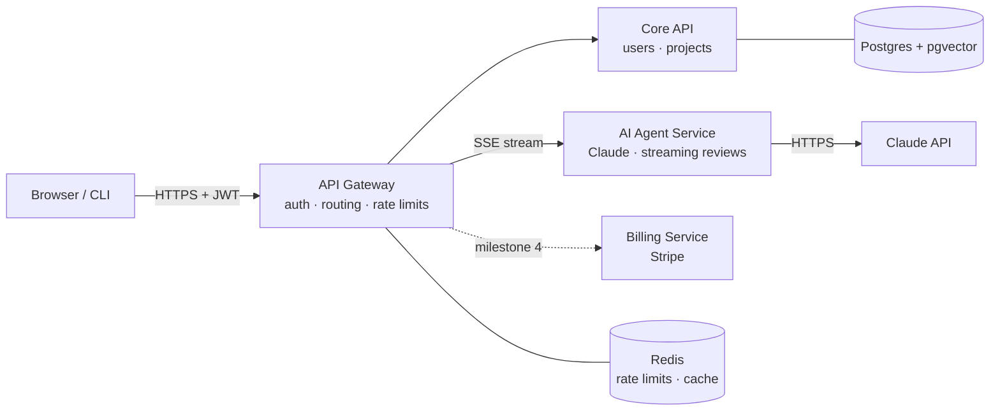

# AI Code Reviewer

A SaaS product that reviews GitHub pull requests with an AI agent and posts
comments back on the PR. Built as a production-style, multi-service system.

> Status: **Milestone 2 of 5** — accounts, API gateway, database, CI, and streaming AI reviews.
> See [LEARNING.md](LEARNING.md) for a step-by-step explanation of how it is built.

## Architecture



Only the gateway is reachable from outside. Every other service sits on a
private network and trusts the user identity the gateway forwards.

## Run it locally

Requires Docker.

```bash
cp .env.example .env            # then set JWT_SECRET (openssl rand -hex 32)
docker compose up --build --wait
./scripts/smoke_test.sh         # sign up, call a protected route, stream a review

git diff | python3 scripts/review.py    # stream a review of your own changes
```

Out of the box `LLM_PROVIDER=fake` returns a canned review, so everything runs
without an API key. For real reviews from Claude, set `LLM_PROVIDER=anthropic`
and `ANTHROPIC_API_KEY` in `.env`, then `docker compose up -d --force-recreate agent`.

API docs: the core service's OpenAPI spec is generated by FastAPI.

| Method | Path | Auth | What it does |
|---|---|---|---|
| POST | `/api/auth/signup` | — | Create account, returns a JWT |
| POST | `/api/auth/login` | — | Returns a JWT |
| GET | `/api/users/me` | Bearer | Current user |
| POST | `/api/reviews/stream` | Bearer | Body `{"diff": "...", "notes": "..."}`; streams the review as Server-Sent Events (`thinking`, `text`, `done`, `error`) |

## Run the tests

```bash
cd services/core && pip install -r requirements-dev.txt && pytest
cd services/gateway && pip install -r requirements-dev.txt && pytest
cd services/agent && pip install -r requirements-dev.txt && pytest
```

CI (GitHub Actions) runs lint and unit tests for each service, then boots the
whole stack with Docker Compose and runs the smoke test against it.

## Roadmap

1. ✅ Accounts, API gateway, Postgres, Redis rate limiting, CI
2. ✅ AI agent service: streaming code reviews from Claude
3. GitHub integration: review PRs and post comments; code embeddings in pgvector
4. Billing with Stripe, plan limits
5. Web dashboard, security hardening, cloud deployment
