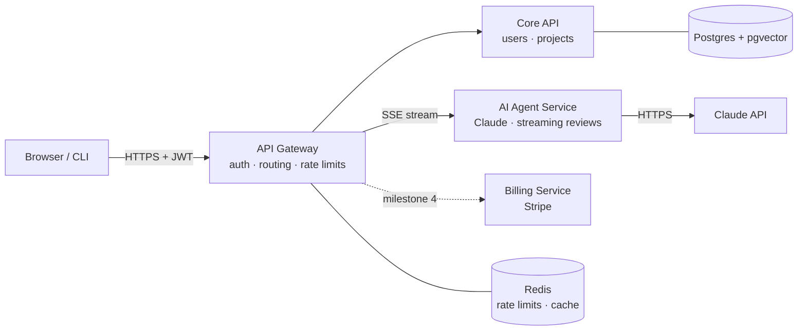

# AI Code Reviewer

[](https://github.com/MITRAKER/genai-saas/actions/workflows/ci.yml)
[](https://github.com/MITRAKER/genai-saas/actions/workflows/codeql.yml)
[](LICENSE)
[](https://www.python.org/)
[](https://github.com/astral-sh/ruff)
[](https://mypy.readthedocs.io/)
[](pyproject.toml)
[](docs/adr/0003-nasa-jpl-power-of-ten-coding-standard.md)
[](.pre-commit-config.yaml)

A SaaS product that reviews GitHub pull requests with an AI agent and posts
comments back on the PR. Built as a production-style, multi-service system.

> Status: **Milestone 2 of 5**: accounts, API gateway, database, streaming AI
> reviews, and professional quality gates (CI/CD, security scanning, NASA/JPL
> coding rules). See [LEARNING.md](LEARNING.md) for a step-by-step explanation
> of how it is built.

## Architecture



Only the gateway is reachable from outside. Every other service sits on a
private network and trusts the user identity the gateway forwards. The
reasons behind this and other big decisions are in [docs/adr](docs/adr/).

## Run it locally

Requires Docker.

```bash
# .env with a fresh secret: the services refuse to start without one
sed "s/^JWT_SECRET=.*/JWT_SECRET=$(openssl rand -hex 32)/" .env.example > .env
docker compose up --build --wait
./scripts/smoke_test.sh         # sign up, call a protected route, stream a review

git diff | python3 scripts/review.py    # stream a review of your own changes
```

Out of the box `LLM_PROVIDER=fake` returns a canned review, so everything runs
without an API key. For real reviews from Claude, set `LLM_PROVIDER=anthropic`
and `ANTHROPIC_API_KEY` in `.env`, then `docker compose up -d --force-recreate agent`.

| Method | Path | Auth | What it does |
|---|---|---|---|
| POST | `/api/auth/signup` | — | Create account, returns a JWT |
| POST | `/api/auth/login` | — | Returns a JWT |
| GET | `/api/users/me` | Bearer | Current user |
| POST | `/api/reviews/stream` | Bearer | Body `{"diff": "...", "notes": "..."}`; streams the review as Server-Sent Events (`thinking`, `text`, `done`, `error`) |

## Develop

```bash
python3.12 -m venv .venv && . .venv/bin/activate
make install      # tools, all service dependencies, git hooks
make check        # lint, format, types, NASA/JPL rules, tests + coverage gate
make              # list every command
```

[CONTRIBUTING.md](CONTRIBUTING.md) describes the workflow, the coding
standard and how to release.

## Quality gates

Every pull request runs these checks in CI, and a change merges only when all
of them pass:

| Check | Tool |
|---|---|
| Lint, formatting, file hygiene | ruff, pre-commit hooks |
| Static types | mypy `--strict` |
| NASA/JPL "Power of Ten" rules | ruff limits + [`tools/jpl_check.py`](tools/jpl_check.py) |
| Unit tests, warnings fail the run | pytest, coverage gate 90% (line and branch) |
| Known vulnerable dependencies | pip-audit |
| Leaked secrets, whole git history | gitleaks |
| Shell scripts, Dockerfiles, workflows | shellcheck, hadolint, actionlint, zizmor |
| Security bugs in code and workflows | CodeQL |
| Whole stack, end to end | Docker Compose + smoke test |

Dependabot proposes dependency updates weekly. Pushing a `vX.Y.Z` tag runs CI
again, publishes the service images to GitHub Container Registry and creates
a release from [CHANGELOG.md](CHANGELOG.md).

## Roadmap

1. ✅ Accounts, API gateway, Postgres, Redis rate limiting, CI
2. ✅ AI agent service: streaming code reviews from Claude
3. GitHub integration: review PRs and post comments; code embeddings in pgvector
4. Billing with Stripe, plan limits
5. Web dashboard, security hardening, cloud deployment

## License

[MIT](LICENSE). Security issues: see [SECURITY.md](SECURITY.md).
