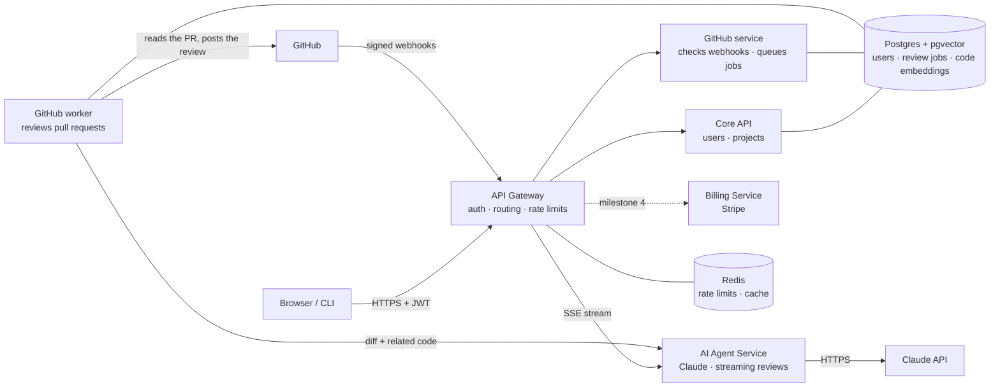

# AI Code Reviewer

[](https://github.com/MITRAKER/genai-saas/actions/workflows/ci.yml)
[](https://github.com/MITRAKER/genai-saas/actions/workflows/codeql.yml)
[](LICENSE)
[](https://www.python.org/)
[](https://github.com/astral-sh/ruff)
[](https://mypy.readthedocs.io/)
[](pyproject.toml)
[](docs/adr/0003-nasa-jpl-power-of-ten-coding-standard.md)
[](.pre-commit-config.yaml)

A SaaS product that reviews GitHub pull requests with an AI agent and posts
comments back on the PR. Built as a production-style, multi-service system.

> Status: **Milestone 3 of 5**: accounts, API gateway, streaming AI reviews,
> professional quality gates (CI/CD, security scanning, NASA/JPL coding
> rules), and now a GitHub App that reviews pull requests, with related code
> found through embeddings in pgvector. See [LEARNING.md](LEARNING.md) for a
> step-by-step explanation of how it is built.

## Architecture



Only the gateway is reachable from outside. Every other service sits on a
private network and trusts the user identity the gateway forwards. GitHub
comes in through the gateway too, and proves who it is by signing every
webhook. The reasons behind this and other big decisions are in
[docs/adr](docs/adr/).

## Run it locally

Requires Docker, `make` and `openssl`.

```bash
make up         # writes .env with fresh secrets, then builds and starts the stack
make smoke      # sign up, call a protected route, stream a review

git diff | python3 scripts/review.py    # stream a review of your own changes
```

Out of the box `LLM_PROVIDER=fake` returns a canned review, so everything runs
without an API key. For real reviews from Claude, set `LLM_PROVIDER=anthropic`
and `ANTHROPIC_API_KEY` in `.env`, then `docker compose up -d agent`.

To see the GitHub integration work without a GitHub account, stop the stack
(`make down`) and run the demo. It starts its own copy of the stack with a
fake GitHub, opens a pull request there, and prints the review the worker
posted on it:

```bash
make demo       # webhook -> queue -> worker -> agent -> review on the fake GitHub
make demo-down
```

| Method | Path | Auth | What it does |
|---|---|---|---|
| POST | `/api/auth/signup` | — | Create account, returns a JWT |
| POST | `/api/auth/login` | — | Returns a JWT |
| GET | `/api/users/me` | Bearer | Current user |
| POST | `/api/reviews/stream` | Bearer | Body `{"diff": "...", "notes": "..."}`; streams the review as Server-Sent Events (`thinking`, `text`, `done`, `error`) |
| POST | `/api/github/webhooks` | GitHub's signature | GitHub's webhooks: a pull request opened or updated queues a review |

## Review pull requests on GitHub

The reviews come from your own GitHub App. It takes about ten minutes:

1. Start the stack with `make up`. GitHub must reach
   `/api/github/webhooks` on it: on a server that is
   `https://<your-domain>/api/github/webhooks`. On your laptop, a proxy such
   as [smee.io](https://smee.io) forwards GitHub's webhooks to
   `http://localhost:8000/api/github/webhooks`.
2. On GitHub, open **Settings → Developer settings → GitHub Apps → New GitHub
   App**, and set:
   - **Webhook URL**: the URL from step 1; **Webhook secret**: the
     `GITHUB_WEBHOOK_SECRET` that `make env` wrote to `.env`.
   - **Repository permissions**: *Contents* read-only and *Pull requests*
     read and write. Nothing else.
   - **Subscribe to events**: *Pull request*.
   - **Where can this GitHub App be installed?**: *Only on this account*.
3. On the app's page, note the **App ID** and **Generate a private key**.
   Save the downloaded key as `secrets/github-app.pem` and run
   `chmod 644 secrets/github-app.pem` (the worker runs as another user in its
   container). Never commit it: git ignores `secrets/`.
4. In `.env`, set `GITHUB_APP_ID` to the App ID and `GITHUB_ALLOWED_ACCOUNTS`
   to the GitHub accounts whose repositories may be reviewed (your login, or
   your organization). Then `make up` again.
5. **Install App** on a repository, open a pull request, and watch the review
   arrive: `docker compose logs -f github-worker`.

Each commit gets one review, posted as a comment: the app never approves or
blocks a pull request. `MAX_REVIEWS_PER_DAY` caps the reviews per
installation. Uninstalling the app deletes the code it indexed. For better
related-code search, set `EMBEDDINGS_PROVIDER=voyage` and `VOYAGE_API_KEY`
(Voyage AI's code model).

## Develop

```bash
python3.12 -m venv .venv && . .venv/bin/activate
make install      # tools, all service dependencies, git hooks
make test-db      # Postgres with pgvector for the github service's tests
make check        # lint, format, types, NASA/JPL rules, tests + coverage gate
make              # list every command
```

[CONTRIBUTING.md](CONTRIBUTING.md) describes the workflow, the coding
standard and how to release.

## Quality gates

Every pull request runs these checks in CI, and a change merges only when all
of them pass:

| Check | Tool |
|---|---|
| Lint, formatting, file hygiene | ruff, pre-commit hooks |
| Static types | mypy `--strict` |
| NASA/JPL "Power of Ten" rules | ruff limits + [`tools/jpl_check.py`](tools/jpl_check.py) |
| Unit tests, warnings fail the run | pytest, coverage gate 90% (line and branch) |
| Known vulnerable dependencies | pip-audit |
| Leaked secrets, whole git history | gitleaks |
| Shell scripts, Dockerfiles, workflows | shellcheck, hadolint, actionlint, zizmor |
| Security bugs in code and workflows | CodeQL |
| Whole stack, end to end | Docker Compose: smoke test, and a pull request reviewed on a fake GitHub |

Dependabot proposes dependency updates weekly. Pushing a `vX.Y.Z` tag runs CI
again, publishes the service images to GitHub Container Registry and creates
a release from [CHANGELOG.md](CHANGELOG.md).

## Roadmap

1. ✅ Accounts, API gateway, Postgres, Redis rate limiting, CI
2. ✅ AI agent service: streaming code reviews from Claude
3. ✅ GitHub integration: review PRs and post comments; code embeddings in pgvector
4. Billing with Stripe, plan limits
5. Web dashboard, security hardening, cloud deployment

## License

[MIT](LICENSE). Security issues: see [SECURITY.md](SECURITY.md).
